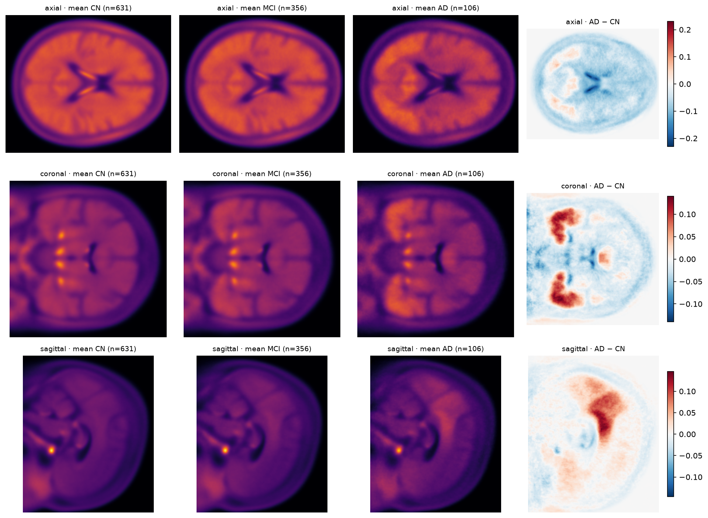
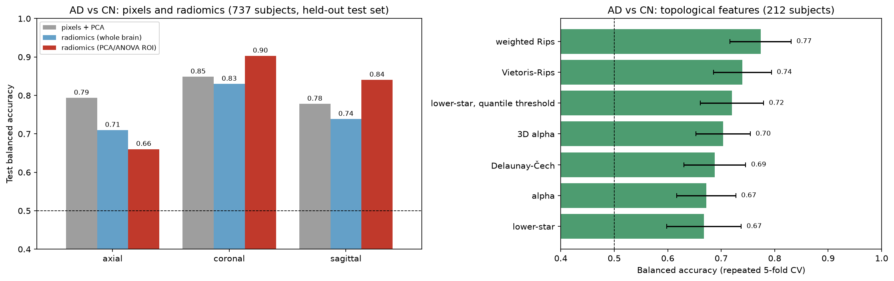
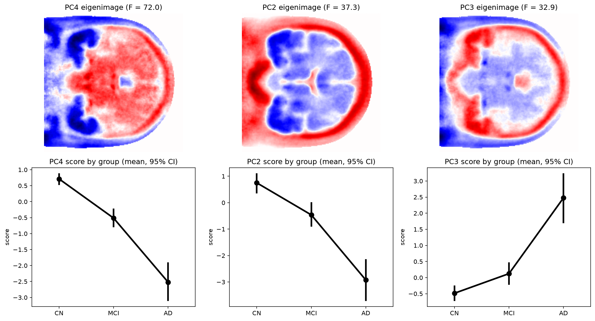

# Statistical and Topological Analysis of Tau-PET Images in Alzheimer's Disease

Exploratory statistical analysis of **tau-PET brain scans** from the
[Alzheimer's Disease Neuroimaging Initiative (ADNI)](https://adni.loni.usc.edu):
cognitively normal (CN) subjects, subjects with mild cognitive impairment
(MCI) and Alzheimer's disease (AD) patients. Three families of methods are
compared:

1. **PCA / eigenimages**: unsupervised modes of variation, plus a
   statistically selected, data-driven **region of interest (ROI)**;
2. **Radiomics**: interpretable intensity and texture features computed in
   the whole brain or in the ROI;
3. **Topological data analysis (TDA)**: persistent homology of the images,
   with five different filtrations.

Each family feeds classical classifiers (logistic regression, SVM, LDA,
random forest) for **AD vs CN** and **CN vs MCI vs AD** classification.

<p align="center">
  
</p>

---

## Key results

<p align="center">
  
</p>

**AD vs CN** (balanced accuracy; models selected by cross-validation on the
training set only):

| features | best view | balanced accuracy | ROC-AUC | evaluation |
|---|---|---|---|---|
| pixels → PCA → logistic regression | coronal | 0.85 | 0.92 | held-out test (222 subjects) |
| radiomics, whole brain | coronal | 0.83 | 0.92 | held-out test (222 subjects) |
| **radiomics, PCA/ANOVA ROI** | **coronal** | **0.90** | **0.95** | held-out test (222 subjects) |
| TDA, lower-star filtration | all views | 0.67 ± 0.07 | – | 5-fold CV ×10 (212 subjects) |
| TDA, lower-star + adaptive threshold | all views | 0.72 ± 0.06 | – | 5-fold CV ×10 (212 subjects) |
| **TDA, weighted Rips** | all views | **0.77 ± 0.06** | – | 5-fold CV ×10 (212 subjects) |

**CN vs MCI vs AD** (radiomics in the ROI, 219 test subjects, chance = 0.33):
single views reach macro-F1 0.42–0.49, early fusion (concatenated views)
0.47, and **late fusion** (averaged per-view probabilities) **0.56**
(balanced accuracy 0.55).

**Main findings**

1. **A data-driven ROI recovers known Alzheimer's anatomy.** Selecting
   principal components by a Welch ANOVA, instead of by explained variance,
   yields regions in the medial temporal lobes and posterior parietal cortex,
   where tau is known to accumulate, plus the ventricles as an atrophy
   marker. No atlas is used.
2. **Simple features in the right place work best.** 88 radiomics features in
   the temporal ROI beat ~30,000 raw pixels. The most discriminative ones are
   plain intensity statistics (90th percentile, mean; Cohen's *d* ≈ 2).
3. **Topology carries signal, but less.** Point-cloud filtrations beat the
   lower-star filtration, and weighting points by intensity helps most.
   Per-image (quantile) thresholds help the lower-star filtration but hurt
   the alpha filtration.
4. **Evaluate small test sets with care.** On the 20-subject TDA test set,
   accuracies range from 0.50 to 0.95 depending on the pipeline, while
   cross-validation puts them between 0.56 and 0.77.
5. **MCI is the bottleneck of the three-class problem.** It is mostly confused
   with CN. With early fusion no AD subject is predicted as CN (errors go to
   MCI), consistent with a disease continuum.

---

## Repository structure

```
├── data/                    # not tracked: see data/README.md to obtain the images
├── notebooks/               # the analysis, in reading order (executed, with outputs)
│   ├── 01_data_and_eigenimages.ipynb
│   ├── 02_pca_roi_discovery.ipynb
│   ├── 03_ad_vs_cn_pixel_pca.ipynb
│   ├── 04_ad_vs_cn_radiomics.ipynb
│   ├── 05_multiclass_radiomics.ipynb
│   ├── 06_tda_lower_star.ipynb
│   ├── 07_tda_point_cloud_filtrations.ipynb
│   ├── 08_tda_3d_and_adaptive_threshold.ipynb
│   └── 09_results_summary.ipynb
├── results/
│   ├── figures/             # every figure saved by the notebooks
│   └── tables/              # metrics as CSV
├── src/adni_tau/            # reusable code (installed as a package)
│   ├── data.py              # ImageLoader, subject-level splits
│   ├── roi.py               # brain mask and PCA/ANOVA region of interest
│   ├── stats.py             # Welch ANOVA on PC scores
│   ├── radiomics_features.py
│   ├── evaluation.py        # grid search + held-out evaluation
│   └── tda/                 # persistent-homology pipeline
│       ├── preprocessing.py, topology.py, templates.py, filtration_3d.py
│       ├── classification.py, pca_analysis.py, plotting.py
│       └── config.py, data.py
├── pyproject.toml
└── requirements.txt
```

## Methods

### Data

One 2D slice per subject and per view (axial, coronal, sagittal), registered
to a common template: **1,093 subjects** (631 CN, 356 MCI, 106 AD). The
classes are strongly imbalanced, so **balanced accuracy** and **macro-F1**
are the main metrics, and models use class weights.

### 1. Eigenimages and a data-driven ROI (notebooks 01–02)

PCA (via SVD) of the brain-masked, centred images gives *eigenimages*. The
components with the most variance are not the ones that separate the
groups: PC1 (44% of the variance) mostly encodes global brightness. A
**Welch ANOVA** on each PC score (Bonferroni, α = 0.01) selects the
discriminative components. Their F-weighted absolute eigenimages are
smoothed, thresholded and cleaned into a **region of interest**. Without any
anatomical prior, it lands on the **medial temporal lobes** (coronal), the
**posterior parietal cortex** (sagittal) and the **lateral ventricles**
(axial, a marker of atrophy).

<p align="center">
  
</p>

### 2. Classification from pixels and radiomics (notebooks 03–05)

- **Pixels**: brain-masked pixels → standardisation → PCA → logistic
  regression or RBF SVM.
- **Radiomics** (pyradiomics: first-order, GLCM, GLRLM, GLSZM, GLDM; 88
  features) in the whole brain mask or in the ROI.
- Hyper-parameters are tuned with stratified 5-fold CV on the training set
  and evaluated once on a held-out, stratified, **subject-level** test set
  (30% for AD vs CN, 20% for three classes).
- Masks and ROIs are fitted on **training subjects only**.
- Three classes: per-view models, **early fusion** (concatenated views) and
  **late fusion** (averaged probabilities).

### 3. Topological data analysis (notebooks 06–08)

Each image is summarised by its **persistence diagrams** in dimension 0
(connected components) and 1 (loops), computed with
[GUDHI](https://gudhi.inria.fr):

| filtration | built on | idea |
|---|---|---|
| lower-star | pixel grid (cubical complex) | sublevel sets of intensity |
| Vietoris–Rips, Delaunay–Čech, alpha | 2D cloud of high-uptake pixels | balls of growing radius |
| weighted Rips | same cloud, intensity-weighted points | strong signal enters first |
| 3D alpha | cloud of (row, column, intensity) | proximity in space *and* uptake |

Diagrams are vectorised as **persistence landscapes**, **Betti curves**,
**lifetime curves** and **barcode statistics**. They are classified by a
**nearest-template** rule (bottleneck / Wasserstein distance to the class
averages) or by a **multi-view logistic regression** on all ≈17,000
features. A PCA variant allows Wald tests on the components. TDA uses a
balanced subset (106 AD, 106 CN; 192 train / 20 test). Because 20 test
subjects give a very noisy estimate, **repeated 5-fold cross-validation** on
all 212 subjects is also reported.

## Reproducing the analysis

```bash
python -m venv .venv
source .venv/bin/activate        # Windows: .venv\Scripts\activate
pip install -r requirements.txt
```

Obtain the data as described in [`data/README.md`](data/README.md), then run
the notebooks in order (`jupyter lab notebooks/`). Notebooks 04, 05 and 07
take 10–40 minutes each, mostly for radiomics extraction and the Rips
filtrations; extracted features are cached in `data/processed/`. Figures
and tables are written to `results/`.

## Limitations

- **Single 2D slice per view.** Volumetric information is lost, and slice
  position or registration differences add noise.
- **Small AD group** (106 subjects), so test sets are small and the
  estimates have wide uncertainty. For the TDA experiments the
  cross-validated numbers are more reliable than the 20-subject test set.
- **Very high-dimensional TDA features** (≈17,000 for 192 subjects): the
  logistic models overfit (train accuracy ≈ 1.0) despite regularisation.
- No external validation cohort, and no covariates (age, sex, APOE).

## Team

Course project in statistical analysis of medical imaging data.

- Roberto Benatuil
- Carlo Misino (team leader)
- Mattia Rusconi
- Ricardo Soto
- Davide Zucchetti

## Acknowledgements

Data used in this project were obtained from the Alzheimer's Disease
Neuroimaging Initiative (ADNI) database (adni.loni.usc.edu). The ADNI
investigators contributed to the design and implementation of ADNI and/or
provided data but did not participate in the analysis or writing of this
work. The images are not redistributed here, in accordance with the ADNI
Data Use Agreement.
